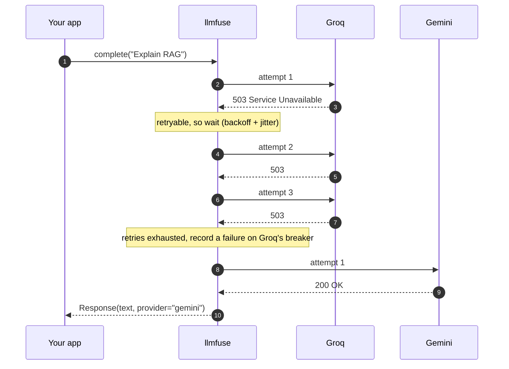
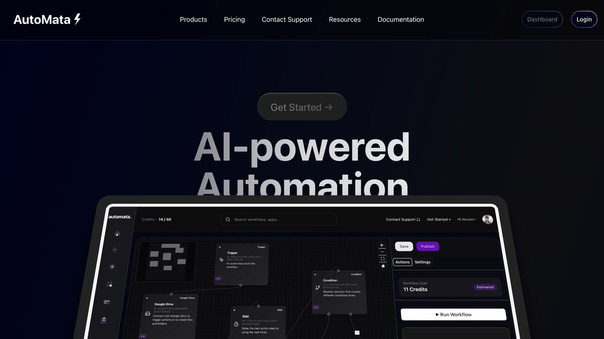
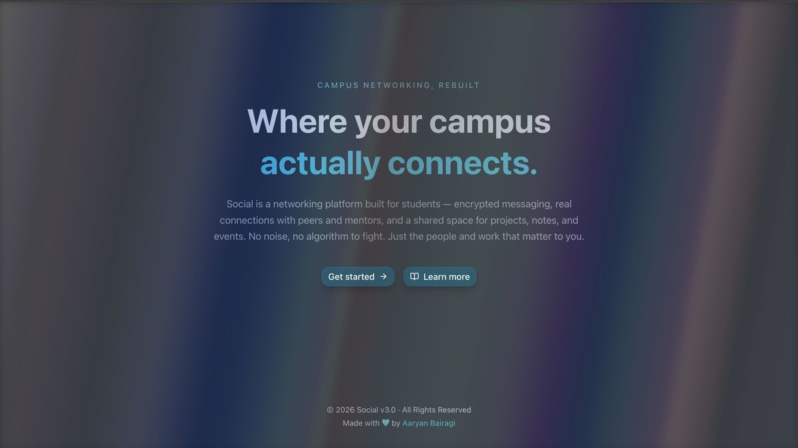
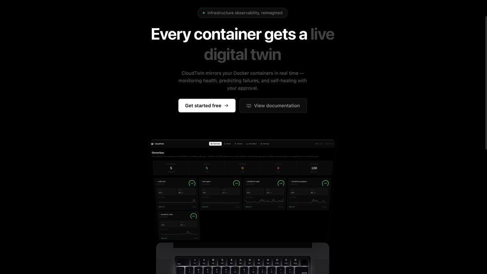
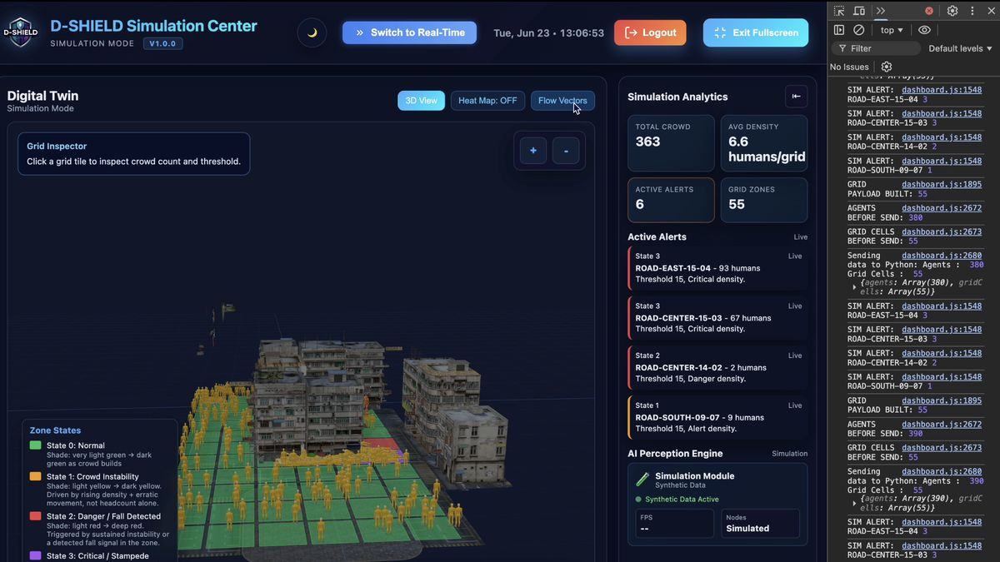
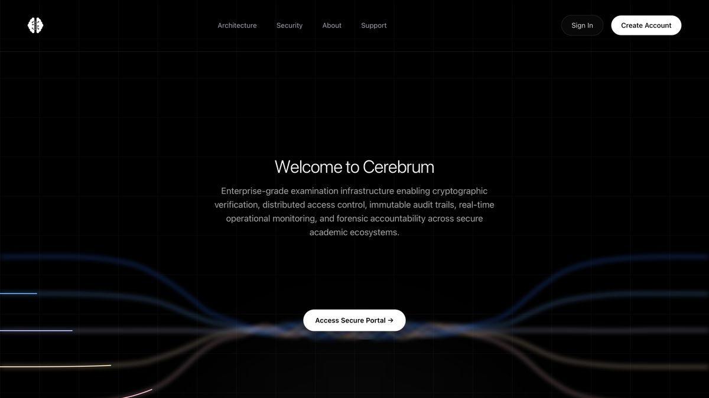

<a id="readme-top"></a>

<div align="center">

<a href="https://aaryanbairagi.in"></a>

<a href="https://aaryanbairagi.in"></a>&nbsp;
<a href="https://aaryanbairagi.in/resume/aaryan-bairagi-resume.pdf"></a>&nbsp;
<a href="https://www.linkedin.com/in/aaryan-bairagi-183249249/"></a>&nbsp;
<a href="mailto:aaryanbairagi1108@gmail.com"></a>

<br/>

<a href="#about"><kbd>&nbsp;About&nbsp;</kbd></a>&nbsp;
<a href="#open-source"><kbd>&nbsp;Open source&nbsp;</kbd></a>&nbsp;
<a href="#featured-projects"><kbd>&nbsp;Projects&nbsp;</kbd></a>&nbsp;
<a href="#experience"><kbd>&nbsp;Experience&nbsp;</kbd></a>&nbsp;
<a href="#tech-stack"><kbd>&nbsp;Stack&nbsp;</kbd></a>&nbsp;
<a href="#github-activity"><kbd>&nbsp;Activity&nbsp;</kbd></a>&nbsp;
<a href="#connect"><kbd>&nbsp;Contact&nbsp;</kbd></a>

</div>

## About

Hello, this is Aaryan Bairagi. I have designed and shipped end-to-end software: event-driven backends, secure APIs, real-time web applications. I care most about the engineering that decides whether a product holds up with real users: fault tolerance, data integrity, security and performance under load. Taking an idea from scratch to something people can actually use, is something that has driven most of what I have done.

Most of my work sits where at least two of these meet:

- **Backend and full-stack:** Node.js, Next.js, TypeScript, PostgreSQL, MongoDB, Redis, WebSockets
- **Applied AI/ML:** LLM integration, async AI pipelines, TensorFlow, Keras, computer vision
- **IoT and edge:** MQTT, Raspberry Pi, real-time ingestion, time-series analytics

I design for scalability, failure tolerance and maintainability from the start, not as an afterthought. That's also why my newest project is a library about failure: [llmfuse](#open-source).

**Open to:** backend, full-stack and ML/AI engineering roles, as an intern or full-time.

## Open source

<a href="https://pypi.org/project/llmfuse/"></a>

[](https://pypi.org/project/llmfuse/)
[](https://pypi.org/project/llmfuse/)
[](https://github.com/AaryanBairagi/llmfuse/actions/workflows/ci.yml)
[](https://github.com/AaryanBairagi/llmfuse#design-principles)
[](https://github.com/AaryanBairagi/llmfuse/blob/main/LICENSE)

**[llmfuse](https://github.com/AaryanBairagi/llmfuse)** is my open-source Python library for calling LLM APIs reliably. You list your providers in priority order. When one is slow, rate-limited or down, llmfuse retries it with backoff, stops calling it once it's clearly broken, and answers from the next one. Your application just gets a response.

```bash
pip install llmfuse
```

```python
from llmfuse import FuseClient
from llmfuse.providers import AnthropicProvider, GeminiProvider, GroqProvider

client = FuseClient(providers=[
    GroqProvider(model="..."),       # tried first
    GeminiProvider(model="..."),     # fallback
    AnthropicProvider(model="..."),  # last resort
])

response = client.complete("Explain retrieval-augmented generation in one sentence.")
print(response.provider, response.text)  # "gemini ..." while Groq is down
```

| When this happens | llmfuse |
|:---|:---|
| Rate limits (HTTP 429) | Paces requests with a per-provider token bucket and honours `Retry-After` |
| Overloaded servers and timeouts | Retries with exponential backoff and full jitter |
| A provider keeps failing | Opens that provider's circuit breaker and skips it until a cool-down passes |
| Bad API keys or unknown models | Fails over at once, with no wasted retries |
| A bug in your own code | Never retried or hidden; it surfaces straight away |

<details>
<summary><b>See one request during an outage</b></summary>
<br/>



</details>

<details>
<summary><b>How it's built</b></summary>
<br/>

- **Zero runtime dependencies.** HTTP goes through Python's standard library, so installing llmfuse adds nothing else.
- **Fully typed.** Ships `py.typed` and is checked with mypy.
- **Testable offline.** Clock, sleep and transport are injectable, and `llmfuse.testing` ships the same fakes the test suite uses, so you can simulate outages without API keys.
- **CI on Python 3.10 to 3.13** with ruff, mypy and pytest.
- **Released through PyPI Trusted Publishing** with signed build attestations.
- **Verified live** against Groq, Gemini, OpenAI and Anthropic.

</details>

**Next:** llmfuse v2, with an async client and routing to idle providers. After that comes **semcache**, a semantic cache for LLM calls that plugs into llmfuse.

llmfuse started from a conversation with Ms. Amruta Nadgonde and was built under the mentorship of Mr. Atul Kahate.

[PyPI](https://pypi.org/project/llmfuse/) &nbsp;|&nbsp; [Source](https://github.com/AaryanBairagi/llmfuse) &nbsp;|&nbsp; [Documentation](https://github.com/AaryanBairagi/llmfuse#readme)

## Featured projects

<table>
<tr>
<td width="50%" valign="top">

<a href="https://automata-gk7u.onrender.com"></a>

### AutoMata

*Workflow automation SaaS. Live on Render.*

Trigger-based automations across Google Drive, Gmail, Slack, Discord, Notion and Google Calendar, on an event-driven runtime written from scratch instead of Zapier, Make or n8n.

`Next.js` `PostgreSQL` `Prisma` <code>OAuth&nbsp;2.0</code> <code>React&nbsp;Flow</code> `Stripe`

[Open app](https://automata-gk7u.onrender.com) &nbsp;|&nbsp; [Demo video](https://www.youtube.com/watch?v=ls9q5mTQj4o) &nbsp;|&nbsp; [Case study](https://aaryanbairagi.in/explore/automata)

</td>
<td width="50%" valign="top">

<a href="https://social-omega-sage.vercel.app"></a>

### Social

*Students and alumni network. Live on Vercel.*

A directed-graph social network with AES-256-GCM encrypted chat, real-time messaging over WebSockets and second-degree connection recommendations.

`Next.js` `MongoDB` `TypeScript` `WebSockets` `Redis` `JWT`

[Open app](https://social-omega-sage.vercel.app) &nbsp;|&nbsp; [Source](https://github.com/AaryanBairagi/social) &nbsp;|&nbsp; [Case study](https://aaryanbairagi.in/explore/social)

</td>
</tr>
<tr>
<td width="50%" valign="top">

<a href="https://cloud-twin.vercel.app"></a>

### CloudTwin

*Digital twin for Docker infrastructure. Live on Vercel.*

Mirrors every container as a live digital twin with a health score and failure-risk prediction, and proposes self-healing restarts that run only after a person approves them.

`Go` `Express` `Next.js` `PostgreSQL` `Redis` <code>Docker&nbsp;Engine&nbsp;API</code>

[Open app](https://cloud-twin.vercel.app) &nbsp;|&nbsp; [Demo video](https://youtu.be/0nN6tu18A8U) &nbsp;|&nbsp; [Case study](https://aaryanbairagi.in/explore/cloudtwin)

</td>
<td width="50%" valign="top">

<a href="https://www.youtube.com/watch?v=MFVBod1bXlw"></a>

### D-SHIELD

*Final-year research project. Paper in progress.*

Real-time stampede risk detection that pairs ML inference with physics-based crowd models, running on Raspberry Pi edge nodes connected to the cloud.

`Python` `Node.js` `MQTT` <code>Raspberry&nbsp;Pi</code> `InfluxDB` <code>Amazon&nbsp;RDS</code>

[Demo video](https://www.youtube.com/watch?v=MFVBod1bXlw) &nbsp;|&nbsp; [Case study](https://aaryanbairagi.in/explore/d-shield)

</td>
</tr>
<tr>
<td width="50%" valign="top">

<a href="https://cerebrum-delta.vercel.app"></a>

### Cerebrum

*Exam integrity platform. In development, with a preview on Vercel.*

Seals exam papers with RSA signatures and AES-256 encryption and records them on a blockchain, so any tampering can be traced to where it happened and who did it.

`Solidity` `Blockchain` `RSA` `AES-256` `Node.js` `TypeScript`

[Preview](https://cerebrum-delta.vercel.app) &nbsp;|&nbsp; [Source](https://github.com/AaryanBairagi/Cerebrum) &nbsp;|&nbsp; [Case study](https://aaryanbairagi.in/explore/cerebrum)

</td>
<td width="50%" valign="top">

<a href="https://quick-vid-phi.vercel.app/"></a>

### QuickVid AI

*Internship project at IBN Technologies. The site is live; video generation is paused because of infrastructure costs.*

Turns a prompt into a finished short-form video: script, scene assets, captions and voice-over, composed with Remotion.

`Next.js` `TypeScript` `Remotion` `AssemblyAI` <code>Google&nbsp;Cloud&nbsp;TTS</code> `Stripe`

[Open app](https://quick-vid-phi.vercel.app/) &nbsp;|&nbsp; [Source](https://github.com/AaryanBairagi/QuickVid) &nbsp;|&nbsp; [Case study](https://aaryanbairagi.in/explore/quickvid)

</td>
</tr>
</table>

### Engineering deep dives

<details>
<summary><b>AutoMata:</b> event-driven runtime, native OAuth and credit billing</summary>
<br/>

| Aspect | Detail |
|:---|:---|
| **Stack** | Next.js, PostgreSQL, Prisma ORM, TypeScript, OAuth 2.0, React Flow, Clerk, Stripe |
| **Architecture** | Event-driven workflow runtime with dependency-aware node orchestration |
| **Integrations** | Google Drive, Gmail, Slack, Discord, Notion and Google Calendar, each through native OAuth 2.0 |
| **Execution** | Asynchronous tasks with webhook triggers |
| **Security** | Custom token lifecycle for every integration: refresh, scope validation and revocation |
| **Billing** | Stripe subscriptions plus usage-based credits; workflows pause automatically when credits run out |

A drag-and-drop builder in React Flow turns automations into graphs of modular execution nodes. None of it sits on third-party middleware: the entire execution layer is built from scratch.

</details>

<details>
<summary><b>Social:</b> graph data model, encrypted chat and recommendations</summary>
<br/>

| Aspect | Detail |
|:---|:---|
| **Stack** | Next.js, MongoDB, TypeScript, WebSockets, Redis, JWT, Cloudinary, Tailwind CSS |
| **Data model** | Directed-edge graph in MongoDB for O(1) follower lookups and efficient follow-request state |
| **Recommendations** | Second-degree traversal with mutual-connection scoring and an explanation for every suggestion |
| **Security** | Chat encrypted with AES-256-GCM before it reaches the database, so messages stay unreadable even if the database is breached |
| **Real time** | WebSocket messaging, likes, comments and notifications without polling |
| **Performance** | Redis-compatible caching and route-level rate limiting to absorb traffic spikes |

</details>

<details>
<summary><b>CloudTwin:</b> monitor, predict, decide, act, confirm</summary>
<br/>

| Aspect | Detail |
|:---|:---|
| **Stack** | Go, Node.js with Express, Next.js, TypeScript, PostgreSQL, Redis, Docker Engine API |
| **Closed loop** | Goes past monitor-and-alert: it predicts, proposes a fix, acts and confirms the result |
| **Health** | A 0 to 100 score that combines CPU and memory into one readable signal |
| **Alerting** | A rules engine on sustained thresholds raises alerts before users notice |
| **Remediation** | A decision engine proposes restarts; the agent runs them only after human approval |
| **Planning** | A what-if simulator projects metrics at higher load from historical trends |
| **Architecture** | Agent-pull pattern, so the backend never needs network access to the host, with per-user workspace isolation |

</details>

<details>
<summary><b>D-SHIELD:</b> edge ingestion, risk propagation and tracking</summary>
<br/>

| Aspect | Detail |
|:---|:---|
| **Stack** | Python, Node.js, MQTT (Mosquitto), Raspberry Pi, InfluxDB, Amazon RDS, JavaScript |
| **Architecture** | Digital twin with a hybrid edge-to-cloud pipeline; ML inference and physics-based crowd analysis in one backend |
| **Ingestion** | Low-latency MQTT publisher-subscriber streaming from sensor hardware to the cloud |
| **Risk model** | Multi-zone risk propagation over connected components, escalating neighbouring zones automatically |
| **Tracking** | Velocity-predicted multi-person identity tracking with adaptive distance thresholds and frame-loss tolerance |
| **Response** | Organisers are alerted and volunteers dispatched, with a human validation step before any escalation |
| **Storage** | InfluxDB for time-series crowd analytics, Amazon RDS for structured data |

</details>

<details>
<summary><b>Cerebrum:</b> paper-leak prevention at the infrastructure level</summary>
<br/>

| Aspect | Detail |
|:---|:---|
| **Stack** | Solidity, Node.js, TypeScript, RSA signatures, AES-256 |
| **Why** | Built in response to leaks like NEET, where a centralised system was a single point of compromise |
| **Integrity** | Smart contracts detect tampering and keep an audit trail on-chain |
| **Security** | RSA signatures verify identity; AES-256 protects paper content |
| **Status** | In development |

</details>

<p align="right"><a href="#readme-top">Back to top</a></p>

## Experience

**Software Engineering Intern**, IBN Technologies Limited<br/>
<sub>Remote, Pune &nbsp;|&nbsp; Jan 2025 – Feb 2025</sub>

Designed and shipped QuickVid AI, a multi-stage AI video pipeline that turns JSON prompts into fully rendered videos: script generation, scene-wise asset creation, caption generation and final composition with Remotion.

- Integrated 4+ external AI services (AssemblyAI, Google Cloud TTS, HuggingFace) with custom async orchestration and fault-tolerant failure handling, so the pipeline kept working through partial service failures
- Built a Stripe subscription and credit billing system with webhook-driven events for real-time access control, automating plan upgrades, downgrades and credit top-ups
- Delivered a production-ready pipeline that handles concurrent video generation requests and degrades gracefully when a service fails

`Next.js` `TypeScript` `PostgreSQL` `Remotion` `Stripe` `AssemblyAI` <code>Google&nbsp;Cloud&nbsp;TTS</code> `HuggingFace`

## Tech Stack

<div align="center">

**Languages**

[](https://skillicons.dev)

**Frontend**

[](https://skillicons.dev)

**Backend & Databases**

[](https://skillicons.dev)

**Cloud, DevOps & Tooling**

[](https://skillicons.dev)

</div>

## AI and ML

| Area | Where I've used it |
|:---|:---|
| LLM systems | **llmfuse:** failover, retries, circuit breakers and rate limiting across LLM providers. **QuickVid AI:** script generation inside a multi-stage video pipeline |
| AI pipelines | **QuickVid AI:** async orchestration across 4+ AI services with fault-tolerant failure handling |
| Computer vision | **D-SHIELD:** velocity-predicted multi-person tracking with frame-loss tolerance |
| IoT and edge | **D-SHIELD:** MQTT (Mosquitto) ingestion from Raspberry Pi sensor nodes to the cloud |
| Data and time series | **D-SHIELD:** InfluxDB crowd analytics. Pandas and Matplotlib for analysis |
| Deep learning | Neural networks, CNNs and transformer models with TensorFlow, Keras and scikit-learn |

## Education

| Programme | Institution | Years | Result |
|:---|:---|:---|:---|
| PGCP-AI | C-DAC ACTS, Pune | 2026–2027 | In progress |
| B.E. Information Technology, Honours in Data Science | P.E.S. Modern College of Engineering, Pune (SPPU) | 2022–2026 | CGPA 8.8 / 10 |
| HSC, Science | Asian College of Science, Commerce & Arts, Pune | 2021–2022 | 86%, ranked 4th in college |
| ICSE | DSK School, Pune | 2019–2020 | 95.6%, ranked 9th in school |

<!-- ---

## Certifications

<div align="center">

**DeepLearning.AI**


**Amazon Web Services**


**MongoDB**


**Google**


**GitHub**


**Postman**


**Meta**


 </div> -->

## GitHub activity

<div align="center">

<picture>
  <source media="(prefers-color-scheme: dark)" srcset="https://github-readme-streak-stats.herokuapp.com/?user=AaryanBairagi&hide_border=true&background=0d0d1a&stroke=7c3aed&ring=6d28d9&fire=a78bfa&currStreakLabel=a78bfa&sideLabels=e2e8f0&currStreakNum=e2e8f0&sideNums=e2e8f0&dates=94a3b8">
  
</picture>

<picture>
  <source media="(prefers-color-scheme: dark)" srcset="https://github-readme-activity-graph.vercel.app/graph?username=AaryanBairagi&bg_color=0d0d1a&color=a78bfa&line=7c3aed&point=c4b5fd&area=true&hide_border=true&area_color=4c1d95">
  <!--  -->
</picture>

<picture> 
  <source media="(prefers-color-scheme: dark)" srcset="https://raw.githubusercontent.com/AaryanBairagi/AaryanBairagi/output/github-contribution-grid-snake-dark.svg">
  
</picture>


</div>

## Current focus

```yaml
current_focus:
  studying:
    - PGCP-AI at C-DAC ACTS, Pune (Aug 2026 – Feb 2027)

  building:
    - llmfuse v2, with an async client and routing to idle providers
    - semcache, a semantic cache for LLM calls that plugs into llmfuse
    - Cerebrum, a decentralized exam integrity platform

  learning:
    - LLM and GenAI engineering (RAG, agents, fine-tuning)
    - Advanced system design and distributed systems

  open_to:
    - Backend, Full-Stack and ML / AI Engineering roles
    - SWE internships and full-time positions
    - Research collaborations in AI / IoT / Security
```

## Connect

<div align="center">

<a href="mailto:aaryanbairagi1108@gmail.com"></a>&nbsp;
<a href="https://www.linkedin.com/in/aaryan-bairagi-183249249/"></a>&nbsp;
<a href="https://x.com/aaryanb4real"></a>&nbsp;
<a href="https://aaryanbairagi.in"></a>

I also post solutions on [LeetCode](https://leetcode.com/u/aaryanb4real/) and [GeeksforGeeks](https://www.geeksforgeeks.org/profile/aaryanbairagi1108), notebooks on [Kaggle](https://www.kaggle.com/aaryanbairagi), and everything else on [Instagram](https://www.instagram.com/aaryanb4real/).

<br/>

*"The best systems are not the ones that never fail — they are the ones that fail gracefully and recover automatically."*

<a href="#readme-top">Back to top</a>

</div>
